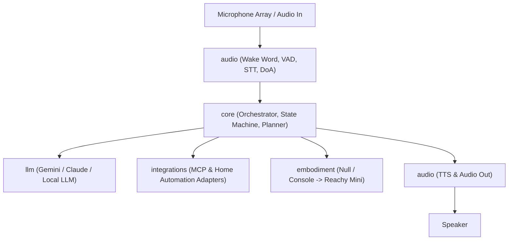
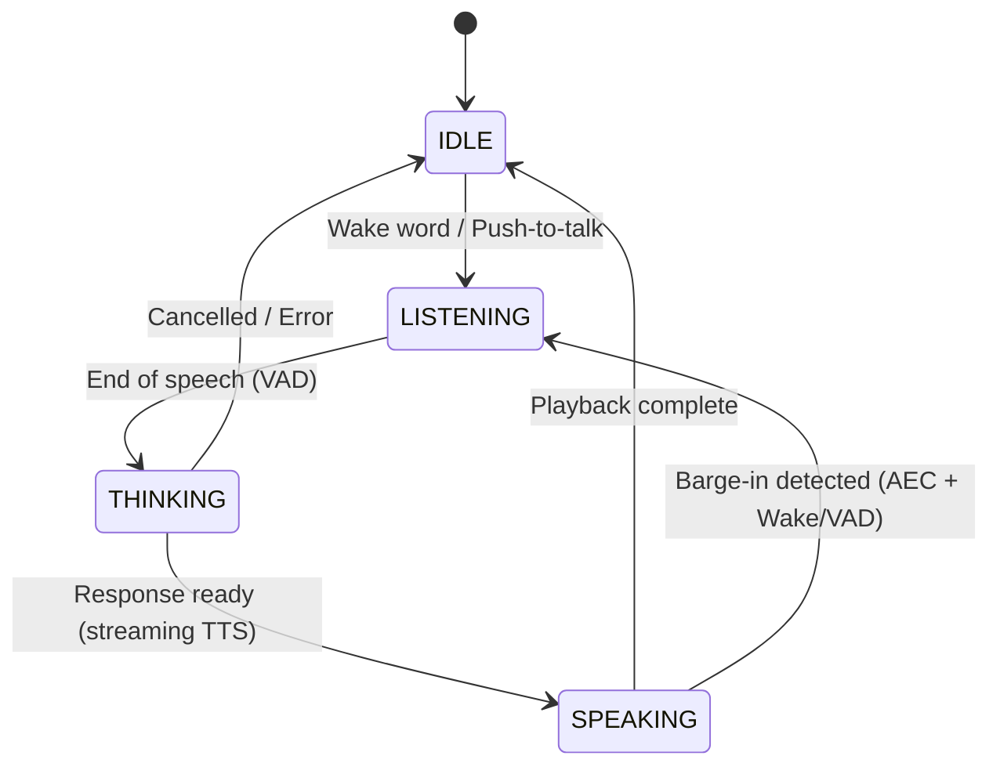

# Software Architecture

This document describes the modular software architecture of **`home_1`**, designed to run cleanly in software-only mode first (desktop or Raspberry Pi CM4) while scaling seamlessly to local LLMs, home automation ecosystems, and physical robotics hardware.

---

## System Overview

---

## Assistant Lifecycle & State Machine

Every voice or text interaction transitions through well-defined assistant states so both audio I/O and physical/visual feedback stay synchronized:

Broadcasting state transitions over a lightweight internal event bus allows the `embodiment` layer (console logs, LEDs, or future servos) to react without coupling directly to the speech or LLM logic.

---

## Module Responsibilities

### 1. `src/home_1/audio/` — Voice Pipeline
Responsible for turning raw room audio into structured transcripts and synthesizing spoken replies:
- **Capture & Playback**: Cross-platform audio I/O (e.g., `sounddevice` / PortAudio / ALSA on Pi CM4).
- **Wake Word**: Local always-on detection (e.g., `openWakeWord`) to avoid streaming ambient room audio to cloud APIs.
- **VAD (Voice Activity Detection)**: Local speech boundary detection (e.g., `Silero VAD`) to detect end-of-utterance cleanly.
- **STT (Speech-to-Text)**: Pluggable interface supporting local (`faster-whisper` / `whisper.cpp`) or cloud/multimodal audio input (e.g., Gemini native audio).
- **TTS (Text-to-Speech)**: Pluggable low-latency synthesis (e.g., local `Piper` on Pi CM4 for snappy offline speech, or cloud neural TTS).
- **DoA (Direction of Arrival)**: Optional metadata emitted by a DSP microphone array indicating the speaker's angle (`0°–360°`).

### 2. `src/home_1/core/` — Orchestrator & Planner
The central coordinator tying the pipeline together:
- **Session & Context Management**: Short-term conversational history and persistent user preferences/notes.
- **Planning Engine**: Structured workflows for personal planning (task capture, daily summaries, reminders, multi-step plans).
- **Tool Dispatch Loop**: Executes model-requested tool calls (home automation actions, calendar/task queries) with clear confirmation rules for sensitive actions.
- **Event Bus**: Publishes typed lifecycle events (`StateChanged`, `UserSpoke`, `DoAUpdated`, `AssistantReplied`) to subscribers.

### 3. `src/home_1/llm/` — Provider-Agnostic AI Layer
Abstracts AI backends behind a common interface supporting streaming responses and structured tool/function calling:
- **Phase 1 Cloud Backends**:
  - **Google Gemini** (`google-genai` SDK)
  - **Anthropic Claude** (`anthropic` SDK)
- **Phase 3 Local Backends**:
  - **OpenAI-compatible / Ollama adapter** pointing to a local machine on the LAN (or a quantized model server) for privacy-first or offline operation.
- **Future Hybrid Routing**: Optional router that handles simple, latency-sensitive home automation intents locally while delegating complex planning or open-ended reasoning to cloud models.

### 4. `src/home_1/integrations/` — Home Automation & Tools
Uses a pluggable tool / **Model Context Protocol (MCP)** adapter pattern so integrations stay decoupled from the core assistant:
- **Home Automation Adapters** (future):
  - Home Assistant (REST / WebSocket API or MCP server)
  - Direct MQTT / Zigbee2MQTT bridge
- **Personal Planning Tools** (future):
  - Local Markdown/SQLite task & note store
  - External calendars / reminders (CalDAV, Google Calendar, etc.)

### 5. `src/home_1/embodiment/` — Software-to-Hardware Bridge
Provides a clean behavioral API independent of physical hardware:
- Example capabilities:
  - `set_state(state)` — `idle`, `listening`, `thinking`, `speaking`, `error`
  - `look_at(azimuth_deg, elevation_deg)` — turns toward active speaker using microphone DoA or vision
  - `express(cue)` — subtle animations (`nod`, `curious`, `happy`, `sleep`)
- **Software-Only Mode**: Backed by `NullEmbodiment` or `ConsoleEmbodiment` (logging states/angles).
- **Pi CM4 Appliance Mode**: Can drive a status LED ring or small OLED face.
- **Reachy Mini-Inspired Mode**: Maps directly to servo/actuator controllers without modifying `core/`, `audio/`, or `llm/`.

---

## Configuration & Runtime Profiles

Configuration will live under `config/` using layered profiles (e.g., `default`, `dev`, `pi-cm4`) combined with environment variables (`.env`, gitignored) for API keys and local endpoints. This makes it easy to develop and test on a laptop and deploy the same codebase to the Raspberry Pi CM4.
